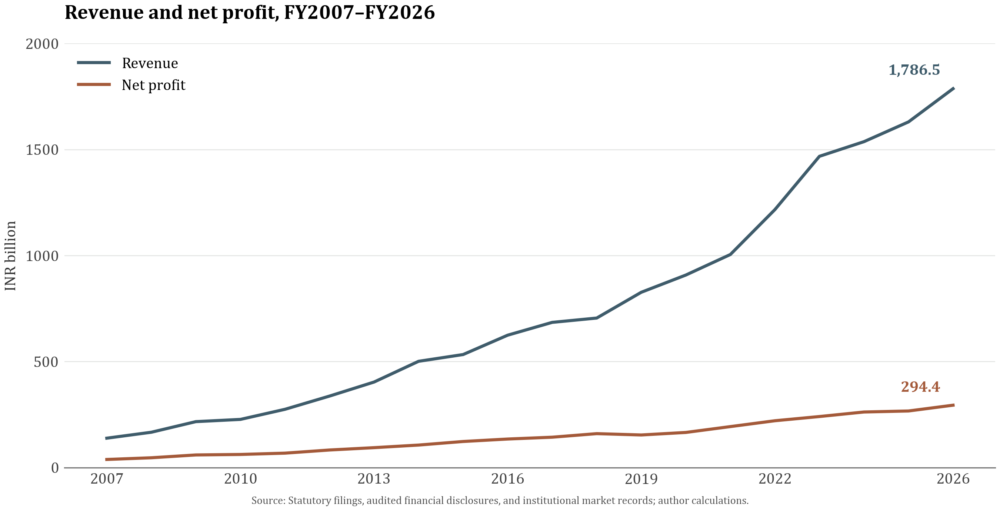
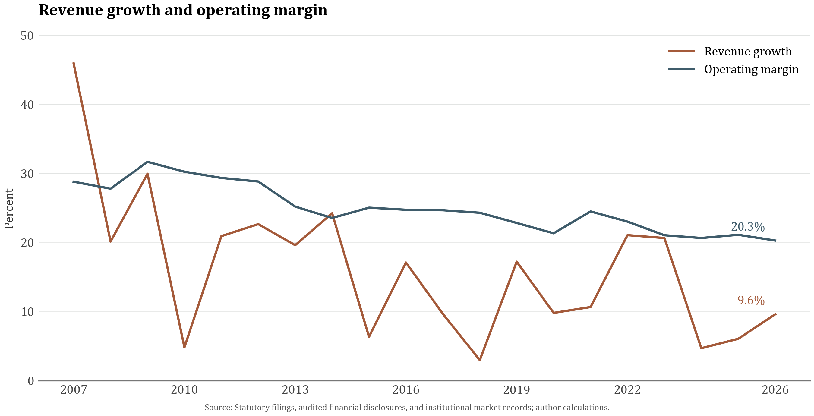
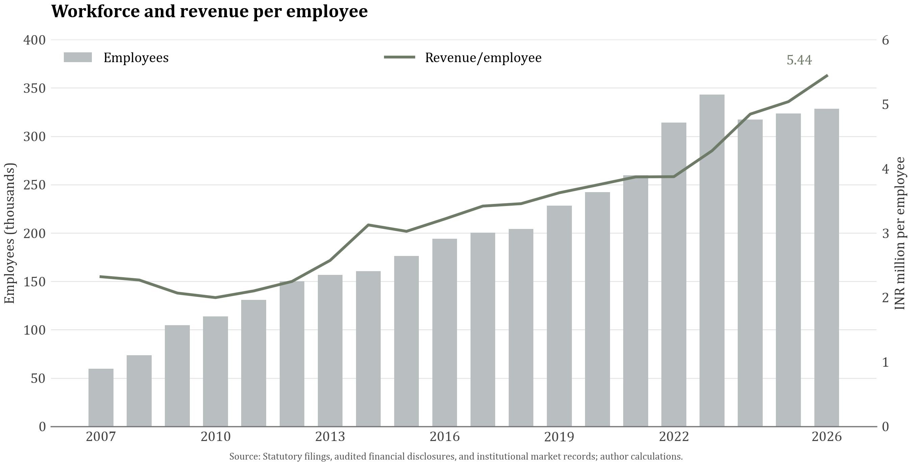
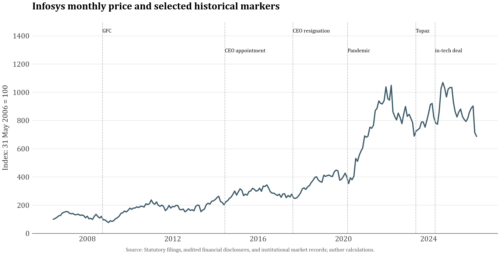
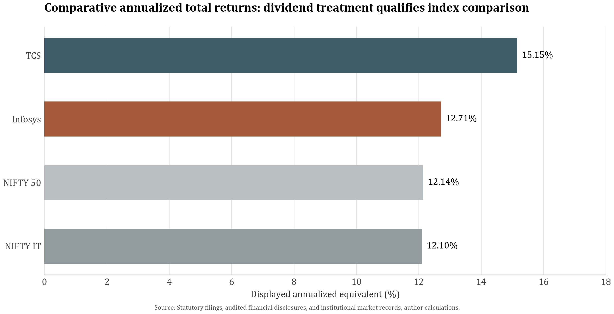
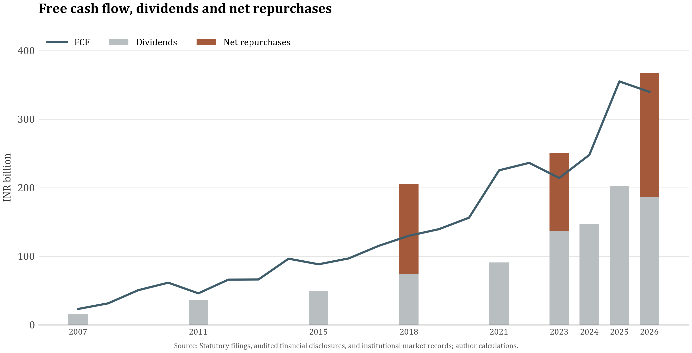
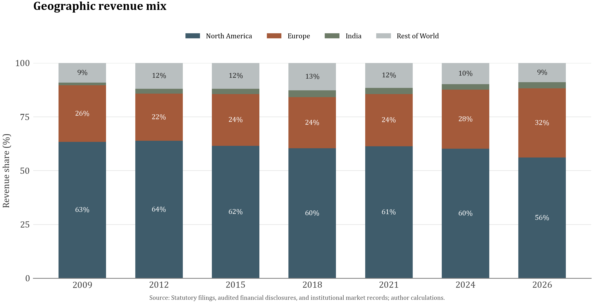
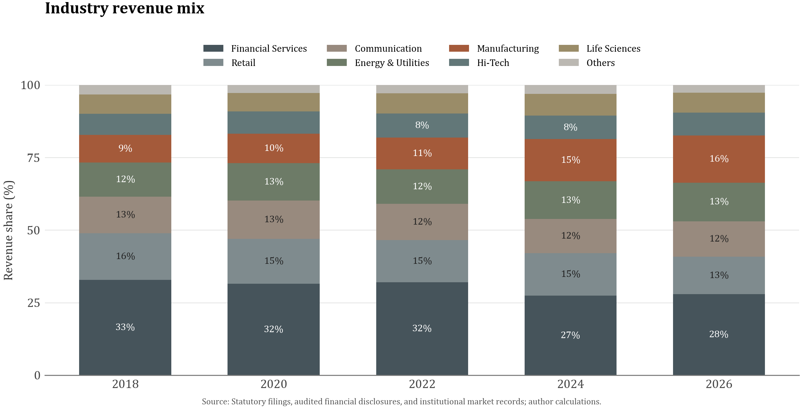

# Scaling with Discipline?
### A Twenty-Year Business History of Infosys (FY2007–FY2026)

[](LICENSE-CODE)
[](https://www.python.org/)
[](output/Scaling_with_Discipline_Infosys_Working_Paper.pdf)
[](output/Scaling_with_Discipline_Infosys_Working_Paper.docx)
[](output/verification_results.json)

> **Author:** **Naman Kumar Sinha**  
> **Affiliation:** Department of Management, Ahmedabad University  
> **Course:** MGT105 – History of Indian Business  
> **Release:** September 2026  
> **Primary Report:** [`output/Scaling_with_Discipline_Infosys_Working_Paper.pdf`](output/Scaling_with_Discipline_Infosys_Working_Paper.pdf) (17 pages, publication-grade working paper with complete observations, interpretations, and reconciliation appendices)

---

## The Core Puzzle: When Scale Destroys Margin

In FY2007, Infosys was a cash-printing machine. For every ₹100 of revenue it brought in, it kept nearly **₹29 in operating profit**. It had zero debt, billions in cash, and an enviable business model: recruit the top 1% of Indian engineering graduates, train them at the palatial Mysore campus, and bill Western Fortune 500s in dollars while paying costs in rupees.

Twenty years later, Infosys pulled off an extraordinary feat of raw scaling. It grew its top-line revenue **twelve-fold**—from ₹138.93 billion to **₹1,786.50 billion ($21B+)**, surviving the 2008 Lehman collapse, navigating an explosive boardroom civil war, weathering the pandemic, and embedding enterprise AI across 90% of its top accounts.

Yet over that exact same twenty-year run:
- **Operating margin lost 850 basis points**, sliding from **28.81% to 20.29%**.
- **Net profit growth lagged top-line growth** by over 300 basis points annualized (11.29% vs 14.39% CAGR).
- **Return on Equity (ROE) compressed** from a staggering 42.32% down to 31.21%.
- **TCS beat Infosys by 577 percentage points** in cumulative equity returns (+1,563% vs +986%).

This paper is the financial and operational autopsy of those twenty years. It addresses a fundamental question in business history and corporate strategy: **When a professional services titan scales twelve-fold, who captures the value—the company, the employees, or the clients?**

---

## The 20-Year Empirical Horizon: Key Metrics

| Indicator | FY2007 | FY2011 | FY2016 | FY2020 | FY2023 | FY2026 | 20-Year Change |
|:---|:---:|:---:|:---:|:---:|:---:|:---:|:---:|
| **Consolidated Revenue** | ₹138.93 B | ₹275.01 B | ₹624.41 B | ₹907.91 B | ₹1,467.67 B | **₹1,786.50 B** | **12.86×** (+14.39% CAGR) |
| **Operating Income (EBIT)** | ₹40.02 B | ₹80.72 B | ₹156.00 B | ₹195.46 B | ₹311.88 B | **₹374.11 B** | **9.35×** (+12.48% CAGR) |
| **Net Income (PAT)** | ₹38.56 B | ₹68.35 B | ₹134.91 B | ₹165.94 B | ₹240.95 B | **₹294.40 B** | **7.63×** (+11.29% CAGR) |
| **Operating Margin** | 28.81% | 29.35% | 24.75% | 21.34% | 21.06% | **20.29%** | **-8.51 percentage points** |
| **Net Profit Margin** | 27.76% | 24.85% | 21.61% | 18.28% | 16.42% | **16.48%** | **-11.28 percentage points** |
| **Return on Equity (ROE)** | 42.32% | 27.31% | 23.15% | 25.45% | 31.97% | **31.21%** | **-11.12 percentage points** |
| **Global Headcount** | 59,831 | 130,820 | 194,044 | 242,371 | 343,234 | **328,594** | Peaked in FY23; -4.3% since |
| **Sales / Employee** | ₹2.32 M | ₹2.10 M | ₹3.22 M | ₹3.75 M | ₹4.28 M | **₹5.44 M** | **+27.15% surge (FY23–26)** |
| **Free Cash Flow (FCF)** | ₹23.15 B | ₹45.95 B | ₹96.88 B | ₹156.25 B | ₹214.13 B | **₹339.72 B** | **14.67×** (+15.19% CAGR) |
| **Cash Conversion (FCF/PAT)**| 60.04% | 67.23% | 71.81% | 94.16% | 88.87% | **115.39%** | Record cash generation |
| **Dividends + Buybacks** | ₹15.32 B | ₹36.64 B | ₹68.13 B | ₹169.87 B | ₹250.95 B | **₹367.09 B** | Payouts exceed annual FCF |

---

## I. The Scale-Margin Paradox: Selling More, Keeping Less

In traditional industrial economics, scaling up builds a moat. High fixed costs are spread over larger output volumes, driving down unit costs and expanding margins. 

Software services inverted this logic.

<div align="center">
  
  <p><em>Figure 1: The divergence between revenue expansion (14.4% CAGR) and profit growth (11.3% CAGR) across twenty fiscal years.</em></p>
</div>

In IT services, there are almost no fixed software assets to amortize. Your primary cost of goods sold is human payroll. As Infosys grew into a global vendor handling mega-contracts ($500M to $1B+ deals with Vanguard, Daimler, and BP), it ran into the **Scale-Margin Paradox**:
1. **Tiered Pricing Pressure:** Massive enterprise clients demanded tiered volume discounts. Winning large multi-year deals meant offering lower billing rates per developer hour.
2. **Onshore Cost Inflation:** Stricter US H-1B visa policies and client demands for co-located agile pods forced Infosys to build expensive local technology hubs in Indianapolis, Raleigh, and Düsseldorf, drastically increasing average compensation per billable head.
3. **The Legacy Commoditization:** Traditional application maintenance and manual infrastructure management faced aggressive bidding from Cognizant, Wipro, and Accenture, pulling baseline contract margins downward.

<div align="center">
  
  <p><em>Figure 2: Annual top-line growth rate swings (%) versus the steady downward drift of operating margin (%) from 28.8% to 20.3%.</em></p>
</div>

As shown in **Figure 2**, while growth surged past 20% during the pandemic digital boom, margins never returned to their pre-2015 heights of 25–28%. Instead, management made a deliberate strategic trade-off: **accept a permanent margin reset into the 20%–22% corridor in exchange for higher absolute dollar volume**.

---

## II. The Labor Treadmill and the AI Decoupling

For its first three decades, Infosys was trapped on a **linear labor treadmill**. If management wanted to grow revenue by 15%, they had to recruit, train, and deploy roughly 15% more engineers.

Between FY2007 and FY2023, Infosys hired over **283,000 net new employees**—expanding its headcount from 59,831 to an all-time peak of 343,234.

Then, in FY2024, the forty-year linear relationship suddenly broke.

<div align="center">
  
  <p><em>Figure 3: Global headcount (thousands, left axis) versus revenue per employee (INR millions, right axis). Notice the sharp decoupling post-FY2023.</em></p>
</div>

Between FY2023 and FY2026:
- **Headcount contracted** from 343,234 to 328,594 (-14,640 employees).
- **Revenue expanded** by ₹318.83 billion ($3.8B+ incremental revenue).
- **Revenue per employee surged +27.15%**, leaping from ₹4.28 million to **₹5.44 million** ($65,000+ equivalent).

### What Drove the Decoupling?
Is this the generative AI revolution at work? The report identifies three converging forces:
1. **The Topaz AI Effect:** Launched in May 2023, Infosys Topaz integrated generative AI suites across software development lifecycles (automated code generation, synthetic test data, legacy code migration). By FY2026, AI-first programs were active across **90% of Infosys's top 200 client accounts** (Infosys Limited, 2026).
2. **Shift to Value-Based & Fixed-Price Contracts:** Under fixed-price delivery, any efficiency gain generated by automation accrues directly to the vendor rather than reducing billable hours.
3. **Pyramid Flattening & Attrition Normalization:** Management rebalanced its onsite-offshore ratios and utilized bench capacity far more aggressively after the hyper-hiring frenzy of 2021–2022.

---

## III. The Vishal Sikka Interregnum: When Silicon Valley Collided with Bangalore

No corporate history of Infosys is complete without understanding its defining leadership crisis: the dramatic three-year tenure of **Dr. Vishal Sikka** (June 2014 – August 2017).

<div align="center">
  
  <p><em>Figure 8: Normalized monthly share price index (May 2006 = 100) mapped against eight critical turning points in macroeconomic and corporate history.</em></p>
</div>

In June 2014, facing growth stagnation and executive departures, the board took a historic step: appointing Dr. Vishal Sikka (former SAP Chief Technology Officer) as Infosys's first non-founder CEO.

Sikka attempted an audacious cultural and strategic pivot:
- **The Strategy:** Shift Infosys from a low-cost IT outsourcer into an innovative software platform company ("Innovate & Automate"), launching internal AI platforms (Mana, later Nia), championing Design Thinking, and acquiring Panaya ($200M) and Skava ($120M).
- **The Theoretical Trap:** This era is a textbook case of James March’s (1991) organizational learning dilemma: **Exploitation vs. Exploration**. An organization perfected for operational discipline, billing utilization, and margin control (*exploitation*) violently rejected the speculative risk-taking, failure tolerance, and Silicon Valley executive pay packages required for software product incubation (*exploration*).
- **The Climax:** Acrimonious public conflict erupted between founding promoters (led by N.R. Narayana Murthy) and the board over corporate governance, Panaya valuation, and executive compensation. On 18 August 2017, Sikka resigned, sending the stock tumbling and forcing co-founder Nandan Nilekani to return as Non-Executive Chairman to steady the ship.

In January 2018, **Salil Parekh** took over as CEO. Parekh eschewed high-concept software platform rhetoric and returned to pragmatic execution ("Navigate your Next"), driving massive cloud transformation deals and repairing relations with the founders.

---

## IV. The TCS Reality Check: Why Stability Beat Vision

Over the two-decade study window, how did an investment in Infosys compare against its peers and the broader Indian economy?

<div align="center">
  
  <p><em>Figure 6: Comparative total-return performance across 239 monthly periods (31 March 2006 to 28 February 2026) derived from institutional market time series.</em></p>
</div>

The data reveals a stark contrast:
- **TCS delivered +1,563.25% total return (15.15% annualized)**, beating Infosys by **2.44 percentage points annualized**—translating into an astonishing **577 percentage point cumulative outperformance**.
- **Infosys generated +985.87% total return (12.71% annualized)**. While Infosys comfortably outgrew the broader Indian market (**NIFTY 50: +880.35% / 12.14%**), it remained in TCS's shadow.

### Why Did TCS Win?
1. **Executive Continuity:** While Infosys navigated three separate leadership transitions, promoter-board battles, and high-profile executive exits, TCS enjoyed decades of seamless leadership succession (S. Ramadorai to N. Chandrasekaran to Rajesh Gopinathan to K. Krithivasan).
2. **Defended Margins:** TCS consistently maintained operating margins 200–300 basis points higher than Infosys by avoiding dilutive mega-deal bidding wars and retaining tighter control over subcontractor costs.
3. **Enterprise Client Dominance:** TCS built entrenched, multi-decade banking architecture relationships through its BaNCS financial platform, creating stickier, higher-margin recurring revenue.

---

## V. Follow the Cash: The ₹367 Billion Distribution Machine

While accounting margins compressed, Infosys's **cash generation machinery underwent a profound evolution**.

<div align="center">
  
  <p><em>Figure 7: Free cash flow compounding alongside annual shareholder cash returns (dividends and net share buybacks). Notice payouts exceeding FCF in FY2026.</em></p>
</div>

### The Transformation of Capital Allocation
1. **The Hoarding Era (FY2007–FY2014):** Traumatized by early memories of capital scarcity, Infosys hoarded cash. In FY2007, it paid out just ₹15.32 billion in dividends, reinvesting little into capex and accumulating billions in bank fixed deposits that dragged down Return on Equity.
2. **The Shareholder Yield Era (FY2018–FY2026):** Confronted by institutional investors demanding capital efficiency, the board fundamentally overhauled its capital allocation policy, committing to return >85% of Free Cash Flow.
3. **The FY2026 Climax:**
   - Free cash flow reached **₹339.72 billion** (a 115.39% conversion of net income).
   - Infosys paid out **₹186.53 billion in regular and special dividends**.
   - Infosys completed **₹180.56 billion in share repurchases**.
   - Total capital returned to shareholders reached **₹367.09 billion**—exceeding annual FCF by drawing down prior reserves and propelling Return on Equity back to **31.21%**.

---

## VI. The New Portfolio: Geography & Verticals

Where does Infosys make its money today compared to fifteen years ago?

<div align="center">
  
  
  <p><em>Figures 4 & 5: 100% stacked revenue mix across geographic delivery markets (FY2009–FY2026) and eight industry segments (FY2018–FY2026).</em></p>
</div>

### Geographic Rebalancing
- **North America Concentration Eased:** From 63.30% in FY2009 down to 56.05% in FY2026 (-7.25 pp).
- **Continental Europe Surged:** From 26.30% to 32.16% (+5.86 pp), driven by multi-year cloud infrastructure modernization contracts in Germany, the UK, and the Nordics.
- **Domestic India Stagnation:** India remained below 3% throughout the two decades, reflecting the stark profitability contrast between overseas enterprise contracts and low-margin government tenders.

### Vertical Diversification
- **Financial Services De-Risking:** Financial services fell from 32.86% to 27.94% (-4.92 pp), shielding Infosys from Wall Street investment banking slowdowns.
- **Manufacturing Emerged as the Star:** Manufacturing expanded from 9.47% to 16.29% (+6.82 pp)—the fastest-growing vertical in the portfolio. Strategic acquisitions like **InSemi** (semiconductor design) and **in-tech** (automotive embedded software) successfully repositioned Infosys inside the connected mobility and smart manufacturing supply chains.

---

## VII. The Accounting Reconciliation (Appendix G)

Academic integrity requires reconciling database metrics with audited statutory filings. In Appendix G, we detail the exact reconciliation between standardized financial series and Infosys Limited’s audited SEC Form 20-F and Annual Report disclosures:

| FY2026 Metric | Standardized Series | Audited Corporate Filing | Variance | Accounting Basis & Mechanism |
|:---|:---:|:---:|:---:|:---|
| **Operating Cash Flow (CFO)** | ₹366.99 B | ₹358.24 B | +₹8.75 B | Working capital classification timing differences |
| **Capital Expenditures (CapEx)**| ₹27.27 B | ₹27.27 B | ₹0.00 B | Exact parity across all filings |
| **Free Cash Flow (FCF)** | **₹339.72 B** | **₹330.97 B** | +₹8.75 B | Follows CFO bridge ($366.99B - $27.27B) |
| **Reported Operating Margin** | 20.29% | 21.00% | -0.71 pp | Company adds back ₹10.5B labour-code provision |

> [!NOTE]
> All underlying data points in this study are derived from publicly filed statutory annual reports and SEC Form 20-F disclosures, preserved in [`data/infosys_annual_fy2007_fy2026.csv`](data/infosys_annual_fy2007_fy2026.csv).

---

## Key Strategic Lessons for Business History

1. **Services Scale Destroys Unit Margins:** In human-capital businesses, revenue scale creates pricing concessions rather than operating leverage. Winning mega-deals requires trading margin percentage for absolute cash volume.
2. **Culture Eats Strategy for Breakfast:** Sikka's failure proved that you cannot mandate innovation inside an enterprise engineered around risk-minimization and utilization metrics.
3. **The Decoupling is Real, but Nascent:** The 27% leap in sales per employee post-FY2023 demonstrates that generative AI and fixed-fee contracts can liberate IT services from linear headcount expansion—if pricing models adapt.
4. **Capital Allocation is the Ultimate ROE Defense:** When industry growth slows from 25% to 8%, aggressive share repurchases and dividend distributions are essential to sustain elite return metrics.

---

## Citation & Replication

### Suggested Citation

If you reference this working paper, empirical findings, or replication dataset:

**BibTeX:**
```bibtex
@techreport{sinha2026infosys,
  author      = {Sinha, Naman Kumar},
  title       = {Scaling with Discipline? A Twenty-Year Business History of Infosys (FY2007--FY2026)},
  institution = {Department of Management, Ahmedabad University},
  year        = {2026},
  month       = {September},
  type        = {Working Paper},
  url         = {https://github.com/notnamansinha/infosys-long-run-analysis}
}
```

**APA (7th edition):**  
> Sinha, N. K. (2026). *Scaling with Discipline? A Twenty-Year Business History of Infosys (FY2007–FY2026)* (Working Paper). Department of Management, Ahmedabad University. https://github.com/notnamansinha/infosys-long-run-analysis

### Reproducing the Entire Study (1-Click Runbook)
```bash
git clone https://github.com/notnamansinha/infosys-long-run-analysis.git
cd infosys-long-run-analysis
pip install -r requirements.txt

# Run the complete analysis, render all 8 charts, and build the 17-page Working Paper
python scripts/build_analysis_data.py --csv
python scripts/verified_charts.py
python scripts/build_report.py

# Run the 235 automated verification tests
python scripts/verify_report.py
```

- **Working Paper:** [`output/Scaling_with_Discipline_Infosys_Working_Paper.pdf`](output/Scaling_with_Discipline_Infosys_Working_Paper.pdf) (17 pages)
- **Word Document:** [`output/Scaling_with_Discipline_Infosys_Working_Paper.docx`](output/Scaling_with_Discipline_Infosys_Working_Paper.docx)
- **License:** Paper text and figures are licensed under [CC-BY-4.0](LICENSE-DOCS). Pipeline code is licensed under [MIT](LICENSE-CODE).
